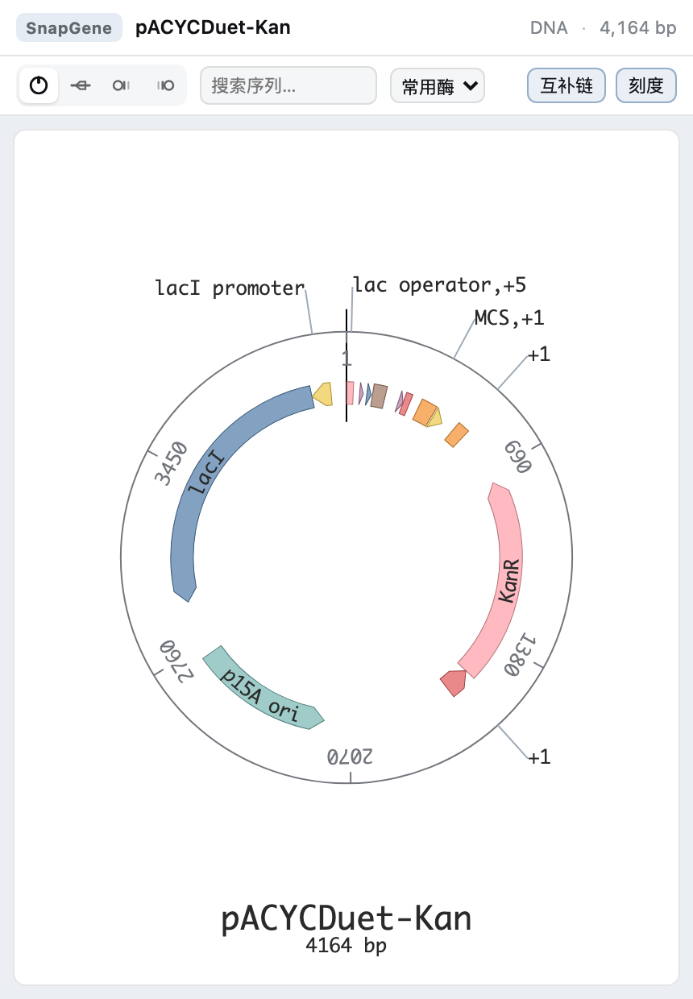
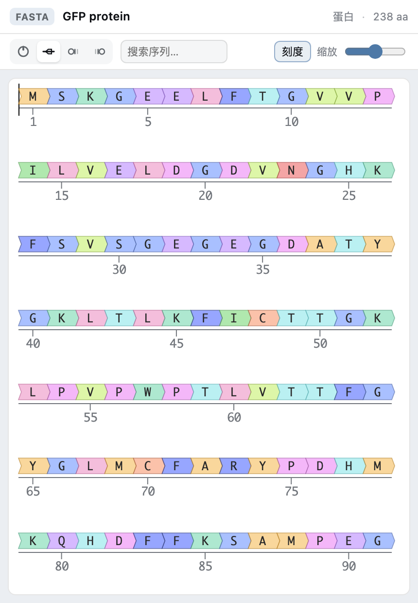
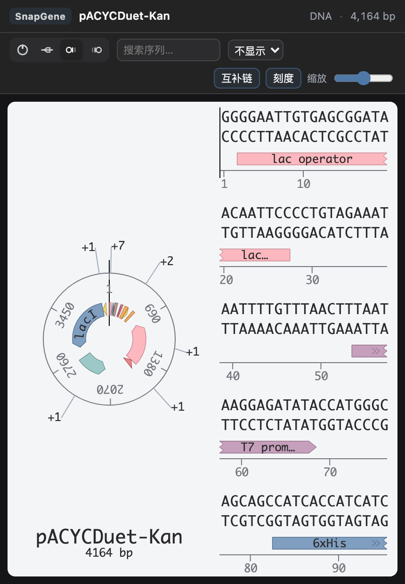

# dsh-gene

DeepSeek Harness 插件：在右侧栏（Sidebar）文件预览里打开质粒、基因和蛋白序列文件，
用 [SeqViz](https://github.com/Lattice-Automation/seqviz) 绘制交互式环状 / 线性图谱，
由 [seqparse](https://github.com/Lattice-Automation/seqparse) 解析文件。

A DeepSeek Harness plugin: opens plasmid, gene and protein sequence files in the
right Sidebar's file preview, parsed with [seqparse](https://github.com/Lattice-Automation/seqparse)
and drawn with the interactive [SeqViz](https://github.com/Lattice-Automation/seqviz) viewer.

---

## 功能 / Features

- **可查看的文件 / Supported files** — SnapGene `.dna`、GenBank、FASTA、SBOL、
  SeqBuilder 等；完整后缀清单与限制见下文「支持的文件格式」。
- **交互式查看器 / Interactive viewer** — 环状、线性、并排、反向并排四种拓扑一键切换。
- **Feature 注释** — 按注释类型自动着色，来自 GenBank / SnapGene 的注释原样呈现。
- **搜索高亮** — 输入序列片段即时高亮；遵循 IUPAC 简并碱基（如 `N`、`K` 会匹配对应碱基集合）。
- **酶切位点** — 不显示 / 常用酶 / 全部酶三档，在环状图上标出切点。
- **互补链与刻度开关** — 线性视图可切换互补链与刻度尺。
- **线性缩放** — 滑块调整线性视图的缩放级别。
- **状态栏** — 格式徽标 + 序列名称 + 类型（DNA / RNA / 蛋白）+ 长度（bp / aa）。
- **拓扑自动判断** — SnapGene 文件读取自身的环状标志位，GenBank 读取 `LOCUS` 行的
  `circular` / `linear`，其余序列默认线性。
- **多记录 FASTA** — 一个文件里有多个序列时出现记录下拉框。
- **文案双语** — 跟随 DSH 的界面语言（中文 / English）。
- **深浅主题自适应** — 工具栏与状态栏跟随 DSH 主题变量；查看区始终使用浅色"纸面"，
  因为 SeqViz 的序列字母使用固定的深色，深色底上会不可读。
- **具名查看器** — 通过 `ctx.documentPreviews` 注册为具名渲染器，出现在预览标题栏的
  查看器下拉菜单里；文本格式仍可切换回"纯文本"，二进制 `.dna` 不提供纯文本回退。

## 支持的文件格式 / Supported formats

查看器只接管下表中的后缀（定义在 `src/client.jsx` 的 `EXTENSIONS` / `BINARY_EXTENSIONS`），
其余后缀仍由 DSH 内置的代码 / 纯文本预览处理。文件由
[seqparse](https://github.com/Lattice-Automation/seqparse) 解析，序列类型（DNA / RNA / 蛋白）
**按内容推断**，不只依赖后缀。

| 后缀 | 文件格式 | 解析路径 | 序列类型 | 纯文本回退 | 备注 |
| --- | --- | --- | --- | --- | --- |
| `.dna` | SnapGene 二进制（含 feature / 引物 / 备注块） | seqparse SnapGene | DNA | ✗ 二进制 | 读取文件自身的环状标志位；不支持使用压缩 DNA 块的极少数文件 |
| `.gb` `.gbk` `.genbank` | GenBank 平面文件 | seqparse GenBank | DNA / RNA（核酸记录） | ✓ | 蛋白记录（`LOCUS` 类型为 `aa`）不支持，见下文 |
| `.ape` | ApE 的 GenBank 变体 | seqparse GenBank | DNA | ✓ | 保留 ApE 的 feature 颜色标签 |
| `.fa` `.fas` `.fasta` `.fna` `.frn` | FASTA 核酸（或裸 DNA 文本） | seqparse FASTA / 内容分派 | DNA / RNA | ✓ | 一个文件多条序列时出现记录下拉框 |
| `.faa` | FASTA 蛋白 | seqparse FASTA | 蛋白（aa） | ✓ | 蛋白序列也可以直接写成 `.fasta` |
| `.seq` | FASTA 或纯 DNA 文本 | 内容分派 | DNA | ✓ | 没有 `>` 头的裸序列同样可以打开 |
| `.sbd` | DNASTAR SeqBuilder | seqparse SeqBuilder | DNA | ✓ | 需要 `Written by SeqBuilder` 头 |
| `.sbol` | SBOL 1 / SBOL 2（RDF/XML） | seqparse SBOL | DNA | ✓ | 按内容区分 v1 / v2 |
| `.xml` | 按内容识别：SBOL / JBEI / BioBrick | 内容分派 | DNA | ✓（推荐回退） | 普通 XML 会提示“不是序列文件”，切回纯文本即可 |

### `.xml` / `.sbol` 的内容识别

这两个后缀最终取决于文件内容，识别依据如下：

| 内容特征 | 识别为 |
| --- | --- |
| 前缀含 `RDF`，或出现 `sbols.org` | SBOL 1 / SBOL 2 |
| `<seq:seq` 或 `jbei.org/sequence` | JBEI |
| `<part_list>` 或 `Parts from the iGEM` | BioBrick（iGEM 元件） |

普通 XML（配置、文档等）不匹配以上任何特征，查看器会显示
「这个文件看起来不是质粒、基因或蛋白序列」，并在预览标题栏的查看器菜单里提供
「纯文本」选项。

### 不支持 / 不在范围内

- **GenBank 蛋白记录**（`LOCUS` 行类型为 `aa`）：seqparse 的 GenBank 解析器只保留碱基字母，
  会把蛋白序列读成残缺的 DNA。查看器会识别并给出提示，请改用 FASTA 蛋白（`.faa` / `.fasta`）。
- **EMBL**（`.embl` / `.dat`）、**Sanger 峰图**（`.ab1`）、**GFF / GTF / BED / VCF**、
  **PDB / mmCIF** 结构文件：没有对应解析器。
- **Benchling JSON**：seqparse 有解析器，但 `.json` 没有登记（否则会接管工作区里所有 JSON 文件），
  可先导出为 GenBank / FASTA。
- **压缩文件**（`.gz` / `.bgz`）：不会自动解压。
- 超过宿主 `maxFileBytes` 上限的文件不会被读取。

> 想新增后缀：在 `src/client.jsx` 的 `EXTENSIONS` 里追加（二进制格式同时加进
> `BINARY_EXTENSIONS`），确认 seqparse 有对应解析器后执行 `npm run build` 重新构建。

## 预览 / Screenshots

| 环状质粒 + 常用酶切位点 | 蛋白序列（线性） |
| --- | --- |
|  |  |

深色主题下的并排视图 / Both views in dark theme:



> 截图来自离线验证 harness（同一套 React 18.3.1 + 真实 `.dna` / FASTA 文件），
> 用于展示查看器本体的排版；在 DSH 右侧栏中由预览面板提供标题栏与查看器菜单。

## 安装 / Install

插件以 bundle 形式安装到当前 DSH profile：

```bash
# 在 DSH 中（推荐）
#   插件管理 → 安装本地 bundle → 选择本目录
# 或通过 agent 的 plugin_manager 工具 install_bundle
```

安装后在 **Settings → Plugins** 里可以看到「基因序列查看器 / Gene Sequence Viewer」，
在右侧栏的文件树里点击任意序列文件即可打开。

## 构建 / Build

浏览器半边（`lib/client.js`）是预构建产物，修改 `src/client.jsx` 后需要重新构建：

```bash
npm install
npm run build          # esbuild → lib/client.js
```

构建脚本有两条刻意保留的约束：

1. `minifyIdentifiers` 保持关闭。esbuild 的标识符压缩会破坏 seqparse 打包后的 FASTA
   解析器（解析结果只剩 1 个碱基）。
2. 打包结果不允许重新缩进。esbuild 会把部分 `"\n"` 字面量降级为内含真实换行的模板
   字符串，插入缩进会改变这些字符串的内容，同样破坏解析器。

## 结构 / Layout

```
dsh-gene/
├── package.json          # bundle 清单 + dsh.bundle / dsh.client
├── cordis.patch.yml      # 插入 dsh-gene 条目
├── src/index.js          # Host 半边（无文件系统操作）
├── src/client.jsx        # 浏览器半边：解析、渲染、注册查看器
├── scripts/build.mjs     # esbuild 打包 + __ModuleLoader__ 包装
├── lib/client.js         # 构建产物（勿手改）
├── locale/{zh,en}.json   # Settings 里显示的标题与描述
└── icon.svg              # 插件图标
```

## 已知限制 / Known limits

- 只读查看，不编辑、不保存文件。
- 酶切位点只在环状视图上绘制（SeqViz 的线性视图不展示 cut site）。
- 超过宿主机 `maxFileBytes` 上限的文件不会读取。
- `.xml` 被登记为该查看器，因为 SBOL 文件通常使用这个扩展名；如果打开的是一般 XML，
  查看器会提示切换到"纯文本"。
- 显存/性能取决于序列长度；超大基因组（> 10 Mb）建议改用专门工具。

## 许可 / License

MIT。第三方组件与许可见 [NOTICE](./NOTICE)。
